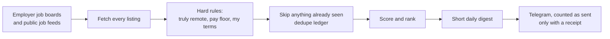

# CareerOS

A job-search engine that runs by itself every morning. It reads job postings
straight from employers' own job boards, throws out the ones that don't fit,
ranks the rest, and sends a short daily list to my phone.

Designed, directed and operated by Javier Elías Crespo; built with Claude Code;
every change verified by running it.

I am not a software engineer. I decided what the system should do, wrote the
rules it follows, directed Claude Code (an AI coding tool) to write the code,
and checked every change by running it and reading the output. I did not write
the Python by hand. What I can do is explain what every part does and why it
is there, and show the tests that prove it.

---

## Proof it's real (measured Oct 17, 2026)

[](https://github.com/javierxelias-svg/careeros-public/actions/workflows/public-proof.yml)

This public copy runs itself every day; see the latest run: **[proof/README.md](proof/README.md)**.

| | |
|---|---|
| **Runs by itself** | Every morning on GitHub Actions. 108 of its first 109 cloud runs passed. The one failure was a break I caused on purpose, to prove the failure alert reaches my phone. |
| **Built over** | 125 commits I directed since July 6, 2026, plus 57 the system made itself (its daily records). |
| **Reads** | 295 employer job boards and 16,258 listings in the Oct 17 run. |
| **Tested** | 25 test files and 886 checks in the live engine, all passing. This Oct 12 copy has 744, also all passing: run `python3 careeros/tests/run_all.py`. |
| **Size** | 13,765 lines of Python in the live engine (12,517 in this copy), standard library only, no third-party packages. |

**Why this repo has one commit:** it is a cleaned public copy, taken Oct 12, 2026. The working repo is private because it holds my personal job-search records. Its history, with the bugs and how each was caught, is in **[BUILD-LOG.md](BUILD-LOG.md)**: 30 dated changes and 7 times the system was confidently wrong.

## How I build it

1. **I write the rule first**, in plain words: what "done" means, what the system must never do.
2. **Claude Code writes the code.**
3. **I run it and read the real output**, not a summary of it.
4. **I break it on purpose**: bad input, a missing key, no network. It has to fail loudly, not quietly.
5. **Nothing is done without a receipt**: a passing test, a message ID, a log line.

What stays out of the AI's hands: secrets (GitHub secrets and the Mac Keychain, never the code), and the decision to send. The scheduled AI routine only pushes a trigger; whether to send is decided in Python against a ledger.

## What it does



Every day it:

1. **Reads job boards straight from the source.** `config/ats-boards.json`
   lists 237 employers' job boards in this Oct 12 copy (341 in the live engine today): 144 on Ashby, 71 on Greenhouse, 14 on
   Lever, 5 on Workday and 3 on Oracle. (Those are the hiring systems companies
   use to post jobs; most of them offer a public feed.) 194 of the 237 are
   switched on; the rest are paused. It also reads 7 public remote-job feeds
   listed in `config/sources.json` (RemoteOK, Remotive, two WeWorkRemotely
   feeds, Hacker News "Who is hiring", Himalayas, Jobicy).
2. **Reads the pay.** `careeros/salary.py` turns pay text like
   "$70,000 - $90,000", "70k-90k USD", "£70,000" or "$100,000 OTE with 30%
   variable" into a number it can compare. OTE ("on-target earnings") is pay
   that includes commission you might not hit, so the system reads the base
   salary, not the headline. When a posting gives no pay at all,
   `careeros/estimate.py` guesses a range from the job title and labels it as a
   guess, so a made-up number never looks like a real one.
3. **Checks the job can really be done remotely.** `careeros/geo.py` reads
   where the job says it can be done from, and drops postings that are
   "remote" in name only (for example, remote but only inside one country the
   operator can't work from).
4. **Scores fit.** `careeros/fit.py` sorts each job title into a lane: core
   (the work I'm aiming for), adjacent (same work, different name), stretch
   (unknown) or off (work I can't get or don't want, such as quota-carrying
   sales). It also checks seniority, required years of experience
   (`careeros/experience.py`) and company type (`careeros/company.py`).
5. **Skips anything already seen.** `careeros/dedupe.py` keeps a ledger (a
   running list) of every job already sent, so the same posting never arrives
   twice.
6. **Sends a daily digest.** `careeros/digest.py` writes the short list and
   `careeros/_shared/notify.py` sends it by Telegram (a messaging app). A send
   only counts as done when Telegram confirms it received the message.

## How it runs

It runs on GitHub Actions (GitHub's servers run it on a schedule, so it does
not depend on my own computer being on). The setup is in
`.github/workflows/daily.yml`:

- A schedule fires every hour (switched off in this public copy, which has no
  Telegram keys; the private copy runs it). `careeros/run_daily.py --if-due` checks whether
  today's digest has already gone out and whether it is past 6:00 local time.
  If not due, it exits in seconds.
- A second trigger fires when a file is pushed to `state/trigger/`. Pushes are
  delivered right away, while GitHub's hourly schedule is best-effort and
  sometimes skipped. The workflow file explains this in its comments.
- It can also be started by hand.
- If any step fails, the last step sends a failure alert to Telegram and checks
  that the alert actually arrived.

It uses only Python's standard library (nothing to install). The workflow
refuses to run if that ever changes without someone updating it.

The Telegram credentials are never in the code. They are stored as GitHub
secrets and read as `${{ secrets.TELEGRAM_BOT_TOKEN }}` and
`${{ secrets.TELEGRAM_CHAT_ID }}`. On a Mac, `careeros/_shared/secrets.py`
reads them from the Keychain first, then from environment variables.

## How it's tested

There are 25 test files in `careeros/tests/`. One command runs all of them:

```
python3 careeros/tests/run_all.py
```

The tests feed the code real-looking inputs and check the outputs: pay strings
in different formats and currencies, job titles that should land in each lane,
location wording that should pass or fail the remote check, duplicate
detection, and the digest format. Many test cases are real postings that once
slipped through a filter; the test makes sure that mistake can't come back.

## Design rules

- **No "this should work."** Nothing counts as done until it has been run and
  the output checked.
- **Receipts.** A message counts as sent only when Telegram returns a message
  ID. If Telegram can't be reached, the message is written to a local file
  instead of being lost (`careeros/_shared/notify.py`).
- **Preflight checks.** Before each run, `careeros/_shared/preflight.py` checks
  that the network is reachable and the Telegram credentials exist and work. If
  a check fails, it sends an alert and stops cleanly instead of crashing.
- **Crash alerts.** Every run goes through `guarded()` in
  `careeros/_shared/runner.py`. Any unexpected error is sent to Telegram with
  the error details, and every run leaves a dated log file.
- **A guess is labelled as a guess.** Estimated pay is marked as estimated and
  can never earn the top rank.
- **Rules in order.** An exclusion (for example, quota sales) can't be
  overridden by a pattern that widens the search. The comments in
  `careeros/fit.py` record each time that ordering went wrong and how it was
  fixed.

## What's NOT in this repo

This is a cleaned public copy. Removed on purpose:

- My personal application history (which jobs I applied to, the dedupe ledger
  of jobs already sent, and the archive of past digests).
- My personal profile, notes and planning documents.
- Personal settings. The salary floors and the take-home pay model in this copy
  are example values, labelled as examples in the code. The hand-written
  per-company notes in `config/curated-notes.json` and
  `config/curated-pinned.json` are replaced with fictional examples.
- Any secrets. None were in the code to begin with; credentials live in GitHub
  secrets and the Mac Keychain.

## Running it yourself

```
python3 careeros/tests/run_all.py          # run the tests
python3 careeros/run_daily.py --dry-run    # build today's digest and print it, send nothing
```

To actually send, set `TELEGRAM_BOT_TOKEN` and `TELEGRAM_CHAT_ID` as
environment variables (or GitHub secrets). Change the example floors in
`careeros/prefilter.py`, the lanes in `careeros/fit.py` and the company lists
in `config/companies.json` to fit your own search.
